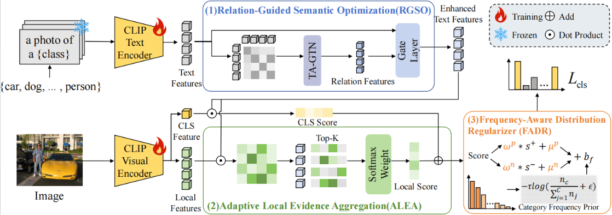

# 🌎 [CoPE] Collaborative Perception Enhancement Framework for Long‑Tailed Multi‑Label Recognition
This is the official implementation of Collaborative Perception Enhancement (CoPE) for long‑tailed multi‑label recognition.

## Overview
<div align="center">
    
</div>

Abstract—Long‑tailed multi‑label image recognition suffers from two core challenges: imbalanced category distribution and complex label co‑occurrence. Most existing CLIP‑based prompt‑tuning pipelines freeze both visual and text encoders and only optimize limited prompt tokens, which lack explicit modeling of inter‑category semantic correlations. To tackle this limitation, we propose a Collaborative Perception Enhancement (CoPE) framework under joint optimization of visual and text encoders. CoPE contains three collaborative modules: Relation‑Guided Semantic Optimization (RGSO), Adaptive Local Evidence Aggregation (ALEA), and Frequency‑Aware Distribution Regularizer (FADR). RGSO leverages the proposed Topology‑Aware Graph Transformer Network (TA‑GTN) to capture latent semantic correlations among categories and refine text representations. ALEA dynamically aggregates discriminative local patch features to capture fine‑grained visual cues under multi‑object scenes. FADR adopts asymmetric transformation together with category frequency priors to mitigate long‑tailed prediction bias. Experiments on VOC‑LT and COCO‑LT demonstrate that CoPE achieves superior performance compared with state‑of‑the‑art vision‑language methods.

## Getting Started
### Environment
All codes are developed with Python 3.9
- PyTorch >= 2.0
- torchvision
- open‑clip‑torch
- transformers
- numpy
- scipy
- tqdm

### Install
Create a virtual environment and activate it.
```shell
conda create -n my_CoPE python=3.9
conda activate my_CoPE
shell
pip install -r requirements.txt
Preparing Datasets
Download VOC‑LT and COCO‑LT datasets and annotations, put data under CoPE-main/data.
The directory should look like:
Shell
CoPE-main/data
├── voc_lt
│   ├── JPEGImages
│   └── annotations
└── coco_lt
    ├── images
    └── annotations
VOC‑LT uses VOC2012 train for training and VOC2007 test for evaluation.
COCO‑LT uses MS‑COCO 2017 long‑tailed train subset, COCO 2017 val as test set.
```

### Training
```Shell
python coco_runner_one.py --dataset voc-lt --num-classes 20 --alpha 0.4 -b 16 --topk 16 --lr 1e-5 --epochs 30 --use_logit --use_gtn
```